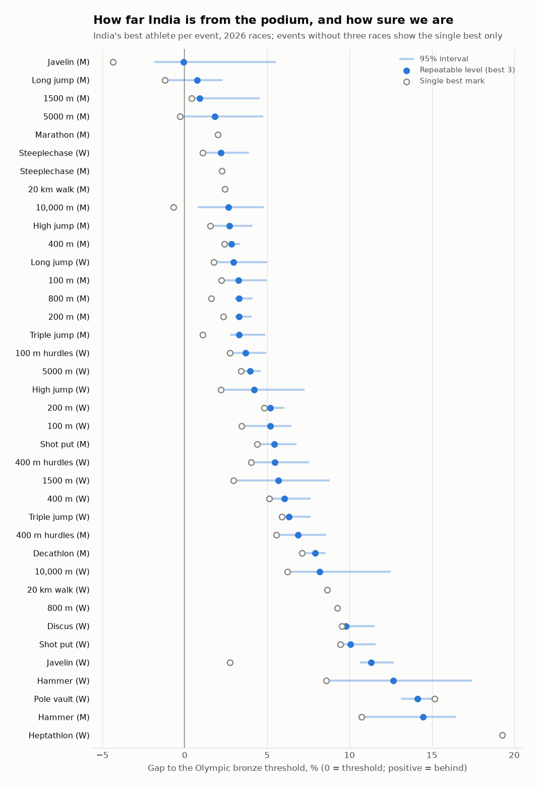
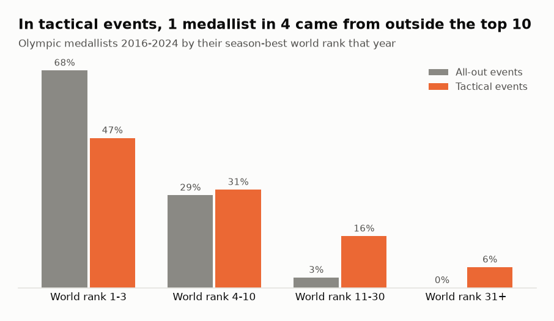
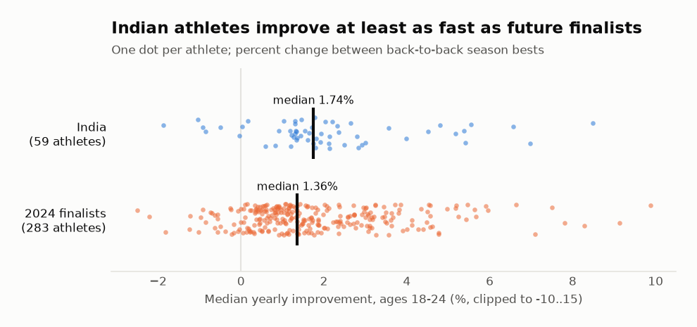
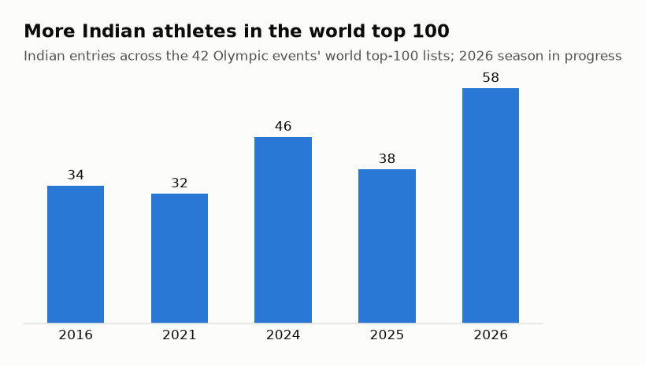
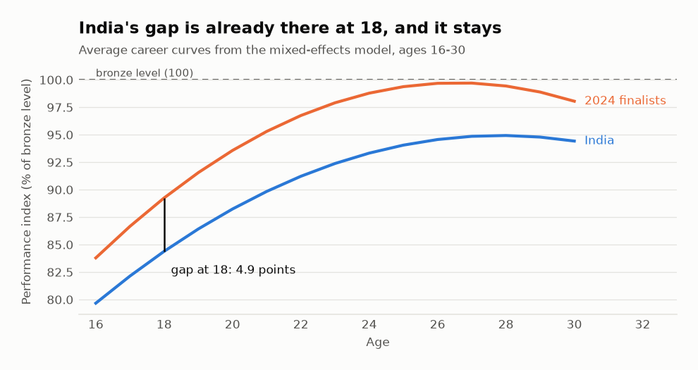
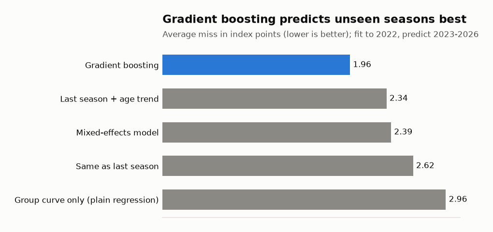
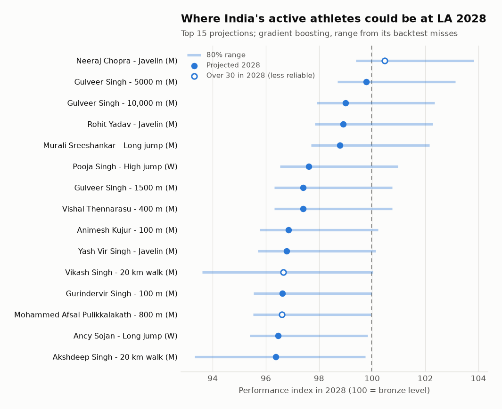
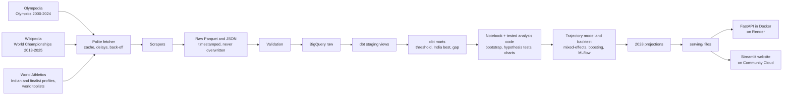
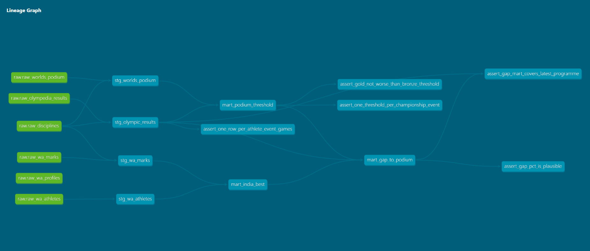

# Gap to the Podium: India vs the World

How far are India's best athletes from an Olympic medal in each athletics event, and which young athletes are on track to win one?

This project collects 25 years of Olympic and World Championship results, the world's top 100 in every Olympic event for five seasons, and the careers of 73 Indian athletes and 307 Olympic finalists. It models them in a cloud warehouse, measures the gap to the podium in every event, tests why the gap exists, and models athletes' careers to find when the gap appears and where India's athletes could be at the 2028 Olympics. The results are served by a live API and a public website; later phases add a Power BI dashboard and a funding case.

> Status (October 2026): Phases 0 to 5 complete, and the Phase 6 website is live. **Website: [open the live site](https://gaptopodium-ey5d4eiebhhyrpxxdruuqz.streamlit.app/)**. **Live API: [gaptopodium.onrender.com](https://gaptopodium.onrender.com)**. The Power BI dashboard is next. See the [roadmap](#roadmap).

## First results

For each event: India's best current mark (outdoor, legal, 2025 to 2026 seasons), the gap to the Olympic bronze threshold (the third-best podium mark, averaged over the last three Games), and World Athletics' own world-list rank for that mark. A negative gap means the mark is better than the threshold. Coverage: 38 of the 42 individual events on the Paris 2024 programme have a current Indian mark (a decathlete's marks no longer stand in for the men's discus, pole vault and 110 m hurdles; the women's marathon has no current Indian athlete).

### Events decided by all-out finals: the gap is a fair measure

Jumps, throws, sprints and hurdles finals are all-out efforts, so the bronze threshold reflects real medal-winning level. Percentages compare fairly only within a group (1% in the 100 m is far harder than 1% in the javelin); the world rank compares fairly across all of them.

| Event | Athlete | Best mark | Gap to bronze | World rank |
| --- | --- | --- | --- | --- |
| Men's javelin | Neeraj Chopra | 90.23 m | -4.37% | 3 |
| Men's long jump | Sreeshankar | 8.38 m | -1.21% | 9 |
| Men's triple jump | Praveen Chithravel | 17.37 m | +1.10% | 10 |
| Men's high jump | Sarvesh Kushare | 2.31 m | +1.56% | 6 |
| Women's long jump | Ancy Sojan | 6.88 m | +1.76% | 12 |
| Women's high jump | Pooja Singh | 1.93 m | +2.20% | 18 |
| Men's 100 m | Gurindervir Singh | 10.09 | +2.23% | 106 |

Neeraj Chopra is ahead of the threshold and third in the world. Sarvesh Kushare is behind on the gap but sixth in the world, so the gap undersells him. Gurindervir Singh's 2.23% looks close, but over a hundred sprinters ran faster: in sprints, small percentages hide deep fields.

### Tactical events: read the world rank, not the gap

In middle-distance, long-distance and road events, Olympic finals are often slow and tactical (the 2016 men's 1500 m bronze was 3:50.24), while Indian bests come from fast, paced races. That makes the gap flattering, so **a negative gap here does not mean India is ahead.** The world rank is the honest measure.

| Event | Athlete | Best mark | World rank | Gap (flattering) |
| --- | --- | --- | --- | --- |
| Women's steeplechase | Parul Chaudhary | 9:08.67 | 11 | +1.10% |
| Men's 10,000 m | Gulveer Singh | 27:00.22 | 12 | -0.67% |
| Men's 5000 m | Gulveer Singh | 13:03.93 | 38 | -0.29% |
| Men's 1500 m | Gulveer Singh | 3:36.58 | 188 | +0.41% |

Parul Chaudhary and Gulveer Singh's 10,000 m sit just outside the world's top 10; in the 5000 m, 38 athletes ran faster than Gulveer that season. Phase 3 tested whether medallists' season bests make a fairer threshold for these events: they don't, because medallists in tactical events often don't race fast times either (see below).

These numbers are a snapshot: 2026 world ranks can change as the season goes on.

## What the statistics say (Phase 3)

Four questions, each answered from the data with a stated method. Full working in [`notebooks/phase3_analysis.ipynb`](notebooks/phase3_analysis.ipynb).

### 1. How sure are the gaps?

A single best mark can be a lucky day. Each event's best Indian athlete is also measured by their **repeatable level**, the mean of their best three races in 2026, with a **95% bootstrap confidence interval** (5,000 resamples of their races).



- On repeatable level, **no Indian athlete is clearly ahead of the bronze threshold**. Neeraj Chopra is level with it (-0.08%, interval -1.85% to +5.52% from four throws); Sreeshankar is next (+0.76%).
- The single best flatters most athletes, and some bests are out of date: Annu Rani's 62.59 (2025) gives a 2.7% gap, her 2026 level 11.3%.
- Consistency varies widely: Vishal Thennarasu's 400 m interval spans under one percentage point (12 races), Tanya Chaudhary's hammer about nine.

### 2. Why tactical events need a different measure (H1, supported)

Olympic distance finals are slow and tactical, so final-race bronze marks understate medal level. Using medallists' **season bests** instead doesn't fix it: the 2024 Olympic 5000 m champion's best time all season ranked 93rd in the world. Matching 373 of 379 podium finishers (2016-2024) to that season's world toplist:



**22.6% of tactical-event medallists ranked outside the world top 10 that season, against 3.2% in all-out events** (one-sided Mann-Whitney U, p < 0.0001). In jumps, throws, sprints and hurdles a medallist is almost always a top-10 performer; in middle distance, long distance and road events about one in four is not. World rank, not a time gap, is the measure there, and a rank just outside the top 10 is a more realistic medal position in those events than in all-out ones.

### 3. Do Indian athletes develop more slowly? (H2, not supported)

Year-on-year improvement between back-to-back season bests at ages 18-24, one median per athlete: **India 1.74% (59 athletes), 2024 Olympic finalists 1.36% (283 athletes)**; one-sided Mann-Whitney U, p = 0.95.



Indian athletes don't improve more slowly, and they peak at the same age (median 25 vs 26). Yet their repeatable levels are 3-10% behind bronze. Since a percentage is relative to the starting level, the evidence points to **a gap that already exists by age 18** and is carried through the career, which suggests investing earlier, in junior development. Phase 4's age curves test this directly.

### 4. Depth is growing



Indian entries in the world top-100 lists rose from 34 (2016) to 46 (2024) and 58 in the 2026 season so far.

**Caveats.** Indian race data covers one season, so intervals are wide for athletes with few races, and their better end is capped at the single best mark. Some athletes appear in several Games, so H1's observations are not fully independent. The Indian group in H2 is mostly athletes who already reached the Olympics or Asian Games, and event mix differs between groups.

## When the gap appears, and who could close it (Phase 4)

Every season best becomes a **performance index**: the mark as a percentage of the event's bronze level (medallists' season bests at the last three Games), so 100 = bronze level, higher is always better, and all 42 events share one scale. That turns each athlete's career into a line of index against age: 72 Indian athletes and 305 athletes who made the 2024 Olympic finals (Indian finalists left out).

### 1. The gap is already there at 18



A **mixed-effects model** fits one average curve per group plus each athlete's own level and improvement rate, so it compares athletes with their own earlier seasons instead of whoever happens to have a mark at each age. Ages 16-30, age measured from 18.

- **At 18, Indian athletes are 4.9 points behind** (95% CI 3.0 to 6.7, p < 0.001). The raw medians say 3.2; the model's number is larger because it also counts athletes whose junior seasons are missing (the ones recorded at 18 were the better juniors).
- **The gap is about 4 points at 16, 5 at 18 and 5-5.5 through the early 20s.** It is set before the development years and carried through them.
- **Improvement after 18 is similar or slightly slower:** -0.3 points a year in the main model (p = 0.058), significant with a cubic curve (-0.66), for women (-0.58) and in throws (-1.30). Indian curves also flatten later, so over 18-24 the rates even out, which agrees with Phase 3's H2.

**Robust:** the gap at 18 is positive in every refit: sprints and hurdles 3.8, jumps 3.9, men 4.5, women 5.4, ages 16-28 only 5.0, cubic curve 5.0. Exceptions are reported, not hidden: in throws the gap at 18 is not significant (junior throwers use lighter implements, which are excluded, so their early seasons are sparse) but they improve more slowly; endurance shows the largest gap (7.8) but that fit was unstable, so it gets no interval.

**What it means:** India's problem is where its athletes start, not how they develop after 18. That points to youth development and talent identification. The data shows *when* the gap appears, not *why*.

### 2. Which model can predict an athlete's future? (backtest)



Fit on seasons up to 2022, then predict the hidden 2023-2026 seasons (899 seasons of 292 athlete-events), split by time so no model sees the future. Five contenders, every run logged in **MLflow**:

- **Gradient boosting wins**, missing by 1.96 points on average, and is best at every horizon. Its lead over the mixed model is real (0.43 points, 95% bootstrap CI 0.27 to 0.59, resampling whole athletes) and over the best simple rule too (0.38, CI 0.21 to 0.55).
- **For Indian athletes alone the two models tie** (difference -0.05, CI -0.45 to 0.30).
- The mixed model is the right tool for *explaining* (the gap at 18, with intervals) but a weaker *forecaster*: it smooths each career into one line and pulls athletes towards their group, so it underrates recent breakthroughs.
- **Honest ranges:** boosting's 80% ranges come from its own misses in an earlier backtest inside the training years (split conformal prediction). In the backtest they held 82% of real values (the mixed model's held 86%). Built-in quantile boosting held only about half the real values on simulated careers, so it was not used. In the backtest the conformal ranges held 82% of real values (aim: 80%).

### 3. Where India's athletes could be at LA 2028



Gradient boosting, trained on every season, projects 44 active Indian athlete-events (a season in 2025 or 2026, at least two seasons on record) to 2028, each with an 80% range taken from its real backtest misses at the same horizon.

- **Only Neeraj Chopra is projected at bronze level** (100.5, range 99.4 to 103.8). He will be 31, past the ages the model trained on, so this one is an extrapolation.
- **Ten more athlete-events have a range that reaches 100:** Gulveer Singh (5000 m, 10,000 m and 1500 m), Rohit Yadav and Yash Vir Singh (javelin), Murali Sreeshankar (long jump), Pooja Singh (high jump), Vishal Thennarasu (400 m), Animesh Kujur (100 m) and Vikash Singh (20 km walk, just touching 100).
- **The standout junior is Pooja Singh**, 19 in 2026, projected at 97.6 for age 21 (range 96.5 to 101.0).

**Read these carefully.** A range reaching 100 means a medal-level season is plausible, not likely. Athletes over 30 in 2028 are flagged (hollow dots): training seasons stop at 30, so their projections are extrapolations. In tactical events, world rank still matters more than the index (see Phase 3).

**Caveats.** The finalists group is selected on reaching the 2024 final, so their 2023-24 seasons were good by selection; every contender faced the same bias, so the comparison is fair, but all models lean pessimistic. Age is season minus birth year. Projections cover athletes in our seed list, not every Indian athlete.

## Use the results: live API (Phase 5)

**[gaptopodium.onrender.com/docs](https://gaptopodium.onrender.com/docs)** has interactive documentation: pick an endpoint, press *Try it out*, and get real data back. (Free hosting sleeps when idle, so the first request after a pause can take up to a minute.)

| Endpoint | Returns |
| --- | --- |
| `GET /findings` | Headline numbers: the gap at 18 with its interval, each model's backtest error, range coverage |
| `GET /events` (`?tactical=true`) | India's best mark, gap to bronze and world rank in every Olympic event |
| `GET /events/{event_key}` | One event, e.g. `/events/jt_m` for the men's javelin |
| `GET /projections` (`?event=`, `?athlete=`, `?reaches_bronze=`, `?limit=`) | 2028 projections with 80% ranges, best first |
| `GET /health` | Status and when the results were generated |

Example: [`/projections?reaches_bronze=true`](https://gaptopodium.onrender.com/projections?reaches_bronze=true) lists the athlete-events whose 2028 range reaches bronze level.

**How it is built:**

- **FastAPI** with typed response models, so inputs are validated (`limit=0` gets a clear 422) and the docs page is generated from the code.
- **Serves precomputed results** from small files in [`serving/`](serving/) instead of querying BigQuery or refitting models per request: fast, free to host, and the numbers change only when the pipeline is rerun and committed. The export writes a fixed set of columns, so the API's contract cannot change by accident.
- **Docker:** a slim Python 3.11 image with only the four packages the API needs, running as a non-root user on the port the host provides. Tests check the Dockerfile copies every module the API imports and that its package versions match the project's.
- **Deployed on Render** straight from this repository: every push rebuilds and redeploys.
- **Prefect** runs the whole pipeline as one flow, `validate → load BigQuery → dbt build → publish`, with scraping first if asked. Each step is logged and timed, retried on failure, and a failed step stops everything after it, so nothing is loaded if validation fails.

## Explore the results: website (Phase 6)

**[The live website](https://gaptopodium-ey5d4eiebhhyrpxxdruuqz.streamlit.app/)** shows every result in one page, built with Streamlit from the same [`serving/`](serving/) files as the API.

- **Dashboard:** the gap at 18 with its 95% range, drawn as a two-lane finish line; the athletes closest to bronze; career curves for India and the 2024 finalists (hover any age); all 42 events ranked against the bronze line, with world rank for tactical events; the five backtested models as a race; and 2028 projections with their 80% ranges, filterable by event, name and whether the range reaches bronze.
- **Mission control:** why the project exists, live checks (API health, age of the results, whether the result files agree, range coverage), the deployed commit and API version, and the phase timeline read from this README.

**How it is built:**

- **Numbers in tested code, drawing kept separate:** every figure comes from pure functions in `src/site_data.py`, tested offline; the modules in `site/ui/` only lay out the page. A test checks the page imports nothing else from `src/`.
- **Custom design system** ("Golden Hour", spec in [`docs/design/dashboard_concept.md`](docs/design/dashboard_concept.md)): colour tokens, frosted panels and HTML/CSS charts instead of stock widgets. The two data colours pass a colour-blindness and contrast check on the dark background.
- **Fails soft:** the API check times out after 2.5 seconds and the page renders from its own files whatever the API's state, so a sleeping free-tier API never breaks the site.
- **Page tests:** Streamlit's test runner loads both views and works every filter and toggle, offline.
- **Deployed on Streamlit Community Cloud** from this repository (`site/app.py`, Python 3.11, versions pinned in `site/requirements.txt`): every push redeploys.

## How it works



- **Collection (Python):** three scrapers share one fetcher that caches every page, waits between requests to each site, backs off when a site refuses (HTTP 429 or 202), and only ever caches real pages.
- **Validation:** one command checks all sources together: medallists have marks, gold beats bronze, no mark is better than the world record, no duplicate athletes, every athlete is Indian. It stops the pipeline if anything fails.
- **Warehouse (BigQuery + dbt):** raw tables load into BigQuery; dbt builds five staging views and three marts, with 40 data tests and a lineage graph.
- **Analysis (Python):** statistics live in tested functions (`src/analysis.py`, `src/charts.py`); the notebook calls them and tells the story.
- **Orchestration (Prefect):** `flows/pipeline.py` runs every step above in order as one flow.
- **Website (Streamlit):** `site/app.py` reads the `serving/` files through `src/site_data.py`.
- **Modelling (Python):** career curves (`src/trajectory.py`, statsmodels), a time-based backtest of five models logged to MLflow (`src/backtest.py`, scikit-learn) and 2028 projections (`src/projection.py`).



## Data sources

| Source | Used for | Notes |
| --- | --- | --- |
| [Olympedia](https://www.olympedia.org) | Olympic results 2000-2024, every athlete in every individual event | Unofficial volunteer site; scraped slowly and cached |
| [Wikipedia](https://en.wikipedia.org/wiki/2023_World_Athletics_Championships) | World Championship podiums 2013-2025 | Secondary source; a fixed random sample of 10 marks matched official results ([check](docs/worlds_crosscheck.csv)). Text is CC BY-SA 4.0 |
| [World Athletics](https://worldathletics.org) profiles | Indian athletes and 2024 Olympic finalists: personal bests, season-by-season progression, this season's races, birth dates, world-list positions | Data embedded in each profile page; every ID comes from a real profile link and is checked against name and country |
| [World Athletics](https://worldathletics.org/records/toplists) toplists | World top 100 per Olympic event, 2016, 2021, 2024, 2025, 2026 (outdoor, one season best per athlete) | Server-rendered HTML tables; Tokyo 2020 is the 2021 season |

## Run it yourself

Requirements: Python 3.11, Git, GNU Make, and the Google Cloud CLI with a free BigQuery sandbox project.

```bash
# 1. Set up
py -3.11 -m venv .venv            # macOS/Linux: python3.11 -m venv .venv
.\.venv\Scripts\Activate.ps1       # macOS/Linux: source .venv/bin/activate
make setup
cp .env.example .env               # then set CONTACT_EMAIL (sent in the scrapers' User-Agent)

# 2. Check everything offline
make check                         # ruff + 362 tests, no internet needed

# 3. Collect and validate the data (Phase 1)
make phase1                        # scrapers, then validation; cached pages make reruns fast

# 4. Load and transform in BigQuery (Phase 2)
gcloud auth application-default login
make load                          # validates first, then loads 6 raw tables
make dbt-build                     # builds and tests every dbt model

# 5. Analysis (Phase 3)
make toplists                      # world top 100 per event and season
make finalists                     # 2024 Olympic finalists' profiles (slow: one page each)
jupyter notebook notebooks/phase3_analysis.ipynb

# 6. Career model, backtest and projections (Phase 4)
jupyter notebook notebooks/phase4_trajectories.ipynb
mlflow ui --backend-store-uri sqlite:///mlflow.db   # compare backtest runs at http://127.0.0.1:5000

# 7. Production (Phase 5)
make pipeline                      # Prefect flow: validate, load, dbt build, publish serving/ files
uvicorn src.api:app --reload       # the API locally at http://127.0.0.1:8000/docs

# 8. Website (Phase 6)
python -m pip install -r site/requirements.txt
streamlit run site/app.py          # the site locally at http://localhost:8501
```

Run `make help` for every command.

## Data quality and testing

- **362 offline Python tests**, built on trimmed copies of real pages, so every tricky case found in the wild stays fixed: a DNF finalist, an annulled gold, a shared bronze with two different marks, an indoor mark filed as outdoor.
- **Models tested on simulated careers with known answers:** the mixed model must recover a planted gap and a planted slower improvement; the backtest must never leak a future season; prediction ranges must hold about 80% of real values.
- **API and deployment tested offline:** every endpoint, filter, missing value and bad input; the Docker setup is checked against the code without needing Docker.
- **Website tested offline:** both views run top to bottom, every filter changes what is shown, and the page still renders when the API cannot be reached.
- **40 dbt data tests** on the warehouse, including one that checks the gap mart has exactly one row for every event at the latest Games.
- **Cross-source validation** before every load.
- **One parser of record:** marks are converted to numbers once, by a tested Python function, and loaded beside the original text.

A few things the checks caught along the way:

- Olympedia's women's 100 m hurdles tables had no marks at all in any Games; marks are now read from each round's own table.
- Wikipedia keeps annulled results in pink rows and writes some road times as `1:26.34` for 1 hour 26 minutes 34 seconds.
- An Indian 5000 m best filed as outdoor had been run indoors; the venue's "(i)" now decides.
- A decathlete's discus and pole vault marks were posing as India's best in those events; combined-event athletes now count only in their combined event.
- Every medallist matched to a toplist season best passes a logic check: a season best can't be worse than the same athlete's Olympic mark that season.
- 19 of 22 World Athletics IDs generated by an AI assistant loaded athletes from other countries; the name and country checks caught all of them, and every ID was looked up again by hand.

## Project structure

```
src/            fetcher, mark parser, event maps, scrapers, validation, BigQuery loader, analysis,
                charts, trajectory model, backtest, projections, publish script, API
flows/          Prefect pipeline
serving/        results the API and website serve (regenerated by `make publish`)
site/           Streamlit website: app.py, and ui/ for the theme, page pieces and views
dbt/            dbt project: staging views, marts, tests, BigQuery profile
tests/          offline Python tests and real-page fixtures
scripts/        exploration helpers used to inspect each source before writing parsers
notebooks/      Phase 3 analysis and Phase 4 trajectory notebooks
data/seeds/     hand-verified Indian athletes; 2024 Olympic finalists matched from toplists
docs/           cross-check sheet, chart images and the website design spec
```

## Roadmap

| Phase | What | Status |
| --- | --- | --- |
| 0 | Setup: repository, environment, Google Cloud | Done |
| 1 | Data acquisition: Olympedia, World Championships, World Athletics, validation | Done |
| 2 | Warehouse and transformation: BigQuery, dbt, gap-to-podium marts | Done |
| 3 | Statistics: bootstrap intervals, two hypothesis tests, fair comparisons for tactical events | Done |
| 4 | Career model, backtest and 2028 projections (mixed-effects, gradient boosting, MLflow) | Done |
| 5 | Production: FastAPI, Docker, Render, Prefect | Done |
| 6 | Public website (Streamlit) and Power BI dashboard | Website done, Power BI next |
| 7 | Business case: funding model and stakeholder deck | Planned |

## License

Code: MIT (see [LICENSE](LICENSE)). Data belongs to its sources: Olympedia, Wikipedia (CC BY-SA 4.0) and World Athletics. Raw data is not stored in this repository; the scrapers rebuild it.
